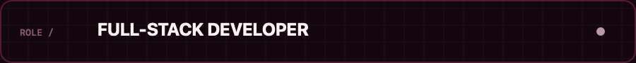
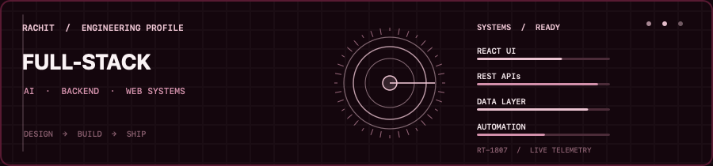
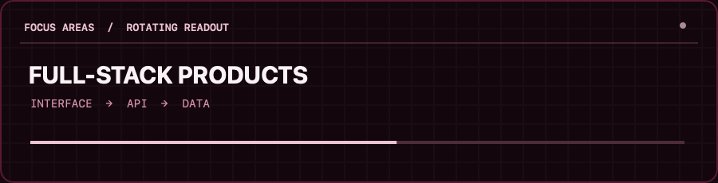
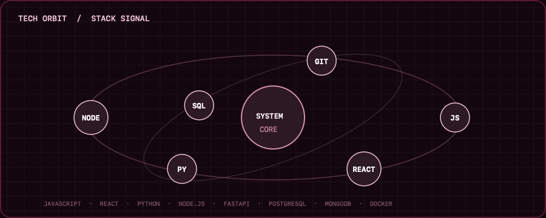
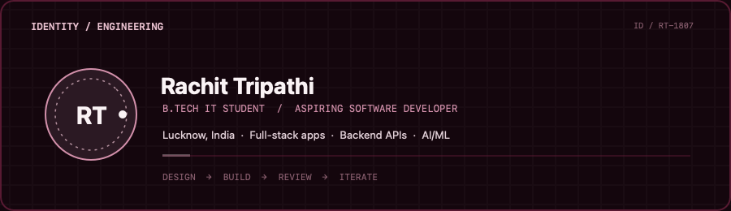
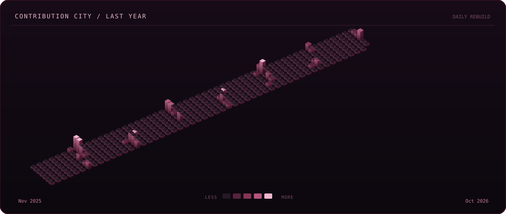

Hi , I'm Rachit.

B.Tech IT student in Lucknow, India · Building practical web apps and developer tools

<a href="https://rachit1807.github.io/rachit-tripathi-portfolio/">PORTFOLIO</a> ·
<a href="https://github.com/rachit1807">GITHUB</a> ·
<a href="https://www.linkedin.com/in/rachit-tripathi-6a7405308/">LINKEDIN</a> ·
<a href="mailto:tripathirachit486@gmail.com">EMAIL</a>

## What I Build

| SYSTEMS | WHAT THEY DO |
|:--|:--|
| **Full-stack products** | Web apps that connect a clean interface to APIs and persistent data. |
| **Backend workflows** | REST services, role-based features, and data-backed application flows. |
| **AI developer tools** | Practical prototypes that apply language models to software workflows. |

## Current Focus

## Tech Orbit & Stack

INTERFACE　/　SERVICES　/　DATA　/　TOOLING

## Identity & Dashboard

<table>
<tr>
<td align="center" width="30%"></td>
<td width="70%"></td>
</tr>
</table>

<table>
<tr>
<td></td>
<td></td>
</tr>
<tr>
<td></td>
<td></td>
</tr>
</table>

## Selected Work & Contribution City

| PROJECT | OVERVIEW | STACK |
|:--|:--|:--|
| **[RailYatra](https://github.com/rachit1807/RailYatra)** | Railway booking simulator with route search, seat allocation, PNR lookup, and downloadable demo tickets. Bookings, fares, and payments are simulated. [Live demo](https://railyatra-api.onrender.com/) | HTML · CSS · JavaScript · Express · PostgreSQL |
| **[TaskFlow Pro](https://github.com/rachit1807/TaskFlow-Pro)** | Project management app with workspaces, roles, Kanban, task assignment, comments, attachments, and activity history. [Live demo](https://taskflow-pro-web.onrender.com/) | React · Vite · Express · MongoDB |
| **[SmartLoanAI](https://github.com/rachit1807/SmartLoanAI)** | Educational loan decision-support prototype with repayment scenarios, model-assisted assessment, sample-document checks, and human review. [Applicant demo](https://smart-loan-ai-one.vercel.app/) | React · FastAPI · PostgreSQL · SQLite |
| **[AI Code Review](https://github.com/rachit1807/AI-Code-Review)** | Structured code-review feedback app powered by a local language model. [Live demo](https://ai-code-review-n5gt.onrender.com/) | React · Express · MongoDB · Ollama |

THE CITY REBUILDS DAILY FROM THE PUBLIC CONTRIBUTION CALENDAR

## Experience & About

- 🎓 B.Tech IT student based in Lucknow, India
- 🌱 Exploring AI/ML, backend development, and web technologies
- 💼 **Full-Stack Web Development Intern — CodeMore** · September 2026–present
- 💼 **Front-End Development Intern — Codveda Technologies** · August–September 2026; built a responsive landing page and a counter app
- 💬 Ask me about web development, APIs, or my projects

## Connect

<table>
<tr>
<td align="center" width="35%"></td>
<td width="65%">

<strong>OPEN CHANNEL / CONNECT</strong>

LinkedIn: <a href="https://www.linkedin.com/in/rachit-tripathi-6a7405308/">linkedin.com/in/rachit-tripathi-6a7405308</a> 
Instagram: <a href="https://www.instagram.com/rachittripathi2509/">instagram.com/rachittripathi2509</a> 
Facebook: <a href="https://www.facebook.com/share/1AsZHEBdie/">facebook.com/share/1AsZHEBdie</a> 
Email: <a href="mailto:tripathirachit486@gmail.com">tripathirachit486@gmail.com</a> 
Portfolio: <a href="https://rachit1807.github.io/rachit-tripathi-portfolio/">rachit1807.github.io/rachit-tripathi-portfolio</a>

</td>
</tr>
</table>
