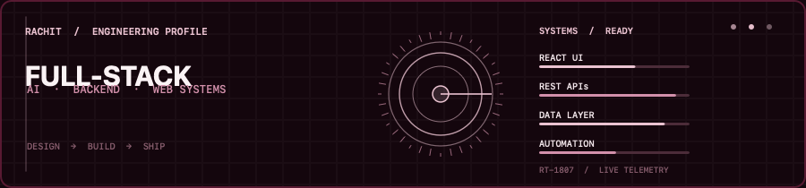

Hi , I'm Rachit.

<strong>B.Tech IT Student · Aspiring Software Developer</strong>

Exploring AI/ML, backend development, and web technologies. I enjoy building practical full-stack apps and developer tools.

<a href="https://rachit1807.github.io/rachit-tripathi-portfolio/">Portfolio</a> ·
<a href="https://github.com/rachit1807">GitHub</a> ·
<a href="https://www.linkedin.com/in/rachit-tripathi-6a7405308/">LinkedIn</a> ·
<a href="mailto:tripathirachit486@gmail.com">Email</a>

## About

- 🎓 B.Tech IT student based in Lucknow, India
- 🌱 Currently exploring AI/ML, backend development, and web technologies
- 💬 Ask me about web development, APIs, or my projects

## Engineering Focus

<table>
<tr><td><strong>01 / INTERFACE</strong> React · JavaScript · HTML · CSS</td><td><strong>02 / SERVICES</strong> Node.js · Express · FastAPI · REST</td></tr>
<tr><td><strong>03 / DATA</strong> PostgreSQL · MongoDB · SQLite</td><td><strong>04 / TOOLING</strong> Git · GitHub · Docker</td></tr>
</table>

BUILD LOOP　→　DESIGN　/　IMPLEMENT　/　REVIEW　/　ITERATE

## Selected Work

| SYSTEM | PURPOSE | STACK |
|:--|:--|:--|
| **[RailYatra](https://github.com/rachit1807/RailYatra)** | Railway booking simulator: route search, seat allocation, PNR lookup, downloadable demo tickets. Bookings, fares, and payments are simulated. [Live demo](https://railyatra-api.onrender.com/) | HTML · CSS · JavaScript · Express · PostgreSQL |
| **[TaskFlow Pro](https://github.com/rachit1807/TaskFlow-Pro)** | Project management with workspaces, roles, Kanban, assignment, comments, attachments, and activity history. [Live demo](https://taskflow-pro-web.onrender.com/) | React · Vite · Express · MongoDB |
| **[SmartLoanAI](https://github.com/rachit1807/SmartLoanAI)** | Educational loan decision-support prototype with repayment scenarios, model-assisted assessment, sample-document checks, and human review. [Applicant demo](https://smart-loan-ai-one.vercel.app/) | React · FastAPI · PostgreSQL · SQLite |
| **[AI Code Review](https://github.com/rachit1807/AI-Code-Review)** | Structured code-review feedback app powered by a local language model. [Live demo](https://ai-code-review-n5gt.onrender.com/) | React · Express · MongoDB · Ollama |

## Experience

- **Full-Stack Web Development Intern — CodeMore** · September 2026–present
- **Front-End Development Intern — Codveda Technologies** · August–September 2026; built a responsive landing page and a counter app

CAREER TRACK　/　LEARN → SHIP → IMPROVE

## Skills

- **Frontend:** JavaScript, React, HTML, CSS
- **Backend:** Python, Node.js, Express, FastAPI, REST APIs
- **Data:** PostgreSQL, MongoDB
- **Tools:** Git, GitHub, Docker

## GitHub Activity

<table>
<tr>
<td></td>
<td></td>
</tr>
<tr>
<td></td>
<td></td>
</tr>
</table>

**🌐 Socials**

